# Surveillance and sensory data collection, approximately 1975–present

## Executive summary

Modern surveillance is not one technology. It is a layered system that can collect **what a person looks like, says, types, buys, watches, reads, searches, drives, touches, wears, visits, breathes, consumes, and does with nearby devices**. It can also infer identity, relationships, routines, health, interests, risk, and intent from those observations. Over the last 50 years, the main change has been from separate records and local sensors to **networked, persistent, linkable data**. A camera image can now be joined to a face template, a license plate, a phone identifier, a payment, a Wi‑Fi observation, a transit tap, or an advertising identifier. FTC work on data brokers and retail tracking shows how data collected in separate contexts can be aggregated and linked to persistent identifiers. citeturn15search7turn20search0

The transition happened in several waves. Computerized government and business records expanded in the 1970s and 1980s. Networked telecommunications, databases, digital biometrics, web logs, cookies, and commercial Internet tracking expanded in the 1990s. Mobile phones, GPS, large biometric databases, cloud services, social networks, and smart-grid systems expanded in the 2000s. The 2010s added smartphones, advertising IDs, Bluetooth/Wi‑Fi location analytics, smart speakers, wearables, connected homes, computer vision, data brokers at very large scale, and pervasive cloud audit trails. Current systems increasingly combine sensors with automated classification and inference rather than only storing a raw observation. NIST's FERET face-recognition program began in 1993; FBI IAFIS became operational in 1999; FCC location and lawful-intercept systems developed through the 1990s and early 2000s; AWS introduced CloudTrail in 2013; Amazon introduced Alexa through Echo in 2014; and Apple released Apple Watch in 2015. citeturn13search1turn0search5turn14search0turn14search7turn18search12turn16search1turn16search14

The less obvious point is that **surveillance does not require a camera or microphone**. A smart meter can expose a time series of energy use; an event data recorder can capture a car's pre-crash state and driver inputs; a Wi‑Fi or Bluetooth radio can expose identifiers and presence; RFID can support tracking, access control, and payment; a browser can be recognized from its configuration; and cloud audit systems can record who performed an action, where, and when. citeturn16search3turn17search1turn20search0turn20search13turn15search1turn18search12

The inventory below contains **292 distinct media or mechanisms**. It includes direct observation, metadata, transactional records, environmental sensing, biometrics, device telemetry, government collection programs, and derived scores. It also includes systems whose main purpose is not surveillance, because the resulting data can still establish identity, behavior, location, associations, or chronology.

## Scope and method

I use **“surveillance and sensory data collection” broadly**. A medium is included when it can create a persistent or queryable observation about a person, device, vehicle, household, transaction, communication, or environment. This includes systems built for safety, billing, authentication, operations, health, advertising, fraud control, or convenience. The inclusion of a technology does **not** mean that every use of that technology is improper surveillance.

The year in the CSV is the earliest practical introduction or documented deployment I could identify for the modern form of the medium. It is **not always the invention date**. For technologies that emerged through several pilots, standards, vendors, or countries, I use `approx.`. For systems that existed before the requested period but remain central to the present surveillance environment, I use `pre-1975` or explicitly mark a pre-scope date. This is important for such systems as payment records, wiretaps, call records, and satellite remote sensing.

Primary sources were preferred. Examples include NIST for biometric and RFID systems, the FBI for federal fingerprint and DNA systems, the FCC for E911 and CALEA, NHTSA for vehicle event recorders, DOE for smart meters, FAA for drones, USGS for satellite observation, W3C/IETF for web mechanisms, FTC material for consumer tracking and data brokers, vendor documentation for launch dates, and PCLOB material for U.S. intelligence programs. NIST records the FERET start in September 1993; FBI sources place IAFIS in July 1999 and the first NGI increment in 2011; CODIS began as a pilot in 1990 and NDIS launched nationally in 1998. citeturn13search1turn0search5turn0search1turn9search5turn9search11

No finite list can prove that it contains literally every sensor, database, or logging system ever deployed. The 292-row inventory therefore aims at **medium-level completeness for systems that can affect an ordinary person**, rather than every vendor product or classified implementation.

## Exhaustive dimensions and media

The bullets below describe the complete set of **collection dimensions** represented in the CSV. The CSV then separates these families into individual media, such as public CCTV versus private CCTV, Wi‑Fi probes versus access-point association logs, or raw health sensors versus the apps that receive their data.

**Visual observation, imaging, and physical space**

- **Fixed public CCTV.** Government and public-space cameras can create time-stamped visual records of presence, movement, companions, vehicles, and events. Modern systems add search, object detection, and other video analytics.

- **Private-business CCTV.** Shops, offices, banks, hotels, warehouses, apartment buildings, and entertainment venues can retain similar records for security, loss prevention, safety, and dispute resolution.

- **Residential and doorbell cameras.** Home-security cameras moved surveillance to doorways, sidewalks, apartment corridors, and neighboring property. Cloud-connected doorbells add event alerts, remote access, and searchable recordings.

- **Police dash cameras and body cameras.** These systems create mobile video and audio records associated with officers and vehicles. U.S. DOJ material notes police body-camera experimentation in the United Kingdom as early as 2005. citeturn13search6

- **Traffic cameras, red-light cameras, and speed cameras.** A road sensor can record a vehicle even when the driver has no direct interaction with the system. Such systems combine imagery, time, direction, speed, and often license-plate data.

- **ANPR/ALPR.** Automatic number-plate or license-plate recognition converts an image of a plate into searchable structured data. Modern ALPR systems can therefore produce location histories rather than only a traffic-enforcement record.

- **Parking and toll plate recognition.** The same basic technology is used for garage entry, parking enforcement, toll billing, and access control, producing records of when a vehicle crossed a specific point.

- **Computer-vision analytics on CCTV.** Video need not be reviewed by a person. Software can count people, detect objects, estimate queues, create heatmaps, flag intrusion, or reconstruct movement through multiple cameras.

- **Facial recognition.** A face image can be converted to a biometric representation and searched against other images. NIST's FERET program began in September 1993 to establish the viability and performance of automatic face recognition. citeturn13search1turn13search5

- **Live facial recognition and face watchlists.** A camera stream can be compared with a watchlist in near real time rather than searched only after an event. This changes face recognition from retrospective identification to continuous screening.

- **Social-network facial recognition and photo clustering.** Consumer photo services can link recurring faces across personal or social images. The FTC's Facebook case specifically addressed the company's facial-recognition setting and photo-tagging-related practices. citeturn21search3

- **Reverse image search and perceptual image matching.** These tools can locate visually similar copies of a photograph even when filenames and ordinary metadata differ. This can connect an image posted in one context with identities or accounts in another.

- **Gait, pose, and body-shape analysis.** Identification or classification can use the way a person walks or moves even when facial detail is poor. Related pose systems estimate body joints and actions.

- **Thermal and temperature imaging.** Infrared systems can reveal heat patterns, human presence, machinery activity, and temperature. Mass temperature screening became especially visible during the COVID-19 period.

- **Depth cameras and LiDAR.** These systems collect geometry rather than ordinary color images. They can map bodies, rooms, pedestrians, vehicles, occupancy, and movement.

- **Security body scanners.** Millimeter-wave and backscatter systems inspect the body for concealed objects. Their main purpose is security screening rather than identity tracking, but they are still a form of automated human sensing.

- **Aerial photography, helicopter surveillance, and drones.** Cameras moved from fixed poles to aircraft, allowing observation across larger areas and from otherwise inaccessible viewpoints. The FAA records its first airworthiness certificate for a civil unmanned aircraft in 2005. citeturn21search1

- **Persistent wide-area aerial observation.** Instead of following one target, wide-area systems can record a large geographic zone and reconstruct earlier movement after an event.

- **Satellite remote sensing.** Earth-observation satellites collect recurring imagery over large areas. Landsat began in 1972, just before this report's main time window, and USGS describes continuous land-surface observation since that date. citeturn21search0turn21search7

- **Commercial high-resolution satellite imaging and street imagery.** Commercial imagery and street-level panoramic services add more detailed, frequently refreshed views that can support mapping, change detection, property analysis, and location intelligence.

- **In-vehicle cameras and driver monitoring.** Modern cars, fleets, taxis, and delivery vehicles can monitor the road and cabin. Driver-facing systems can estimate gaze, attention, distraction, fatigue, and seat occupancy.

- **Retail shelf cameras and cashierless vision.** Computer vision can identify products, hands, carts, shelf state, and customer movement. In these systems, observation becomes part of the checkout process itself.

**Audio and acoustic observation**

- **Wiretaps and call-content interception.** Interception of communication content predates the period in this report, but digitization and modern telecommunications made collection easier to route, store, and search. CALEA, enacted in 1994, requires covered communications systems to preserve capabilities for legally authorized electronic surveillance. citeturn14search1turn14search7

- **Call recording and voicemail.** Customer-service, financial, emergency, and workplace systems can retain voices, conversational content, timestamps, caller numbers, and later automated transcripts.

- **Gunshot detection.** Distributed microphones can classify impulsive sounds and estimate where gunfire occurred. This converts ambient urban sound into a continuously monitored public-safety signal.

- **General public microphone networks.** Acoustic sensors can also detect alarms, breaking glass, traffic noise, machinery, crowd noise, or other events without recording traditional telephone calls.

- **Voice assistants and smart speakers.** Voice interfaces use microphones and audio processing to recognize commands and activate services. Amazon states that Alexa was first introduced through the Echo family; the first Echo/Alexa launch was in 2014. citeturn16search1

- **Smart-TV microphones and automatic content recognition.** Connected televisions can collect voice commands and recognize what is displayed on the screen. The FTC alleged that Vizio collected second-by-second viewing information from millions of smart TVs; FTC material states that the relevant practice started in 2014. citeturn16search2turn16search21

- **Voiceprints and speaker recognition.** Systems can model how a person speaks for authentication, fraud detection, or identification rather than only transcribing words.

- **Speech sentiment and emotion analysis.** Call centers and automated systems can derive features such as tone, pace, interruption patterns, or predicted sentiment from speech.

- **Ultrasonic and ambient-audio device linkage.** Signals outside normal conversational use can be used to infer that two devices are near one another or exposed to the same media environment.

**Biometric identity and body signals**

- **Fingerprint databases and AFIS.** Automated fingerprint matching became a major criminal-justice identity tool during the 1980s and 1990s. NIST notes that automated fingerprint matching was becoming a key criminal-justice tool in the early 1990s as the FBI planned IAFIS. citeturn13search26

- **IAFIS and NGI.** FBI IAFIS became operational in July 1999, while the first increment of its successor, Next Generation Identification, was deployed in February 2011. citeturn0search5turn0search1

- **Iris, retina, palm, hand geometry, and vascular biometrics.** These systems convert eye, hand, or vein patterns into identity features for access control, border systems, timekeeping, or authentication.

- **Behavioral biometrics.** Keystroke timing, mouse movement, touch gestures, and other interaction patterns can help recognize or score a user without a traditional fingerprint or face scan.

- **Eye and pupil tracking.** Sensors can record gaze direction, fixation, pupil response, and attention. These signals can support accessibility and interface control, but can also expose behavioral or cognitive information.

- **Heart and ECG signals.** Wearables and health systems can collect heart rate, rhythm, and related physiological measurements. Apple introduced Apple Watch with a built-in heart-rate sensor and released the first Watch in 2015. citeturn16search0turn16search14

- **Face-based emotion inference.** Computer-vision systems can attempt to infer expressions or affective state from facial motion. Such inferences are distinct from face identification even when the same camera supplies the data.

- **Border and airport biometrics.** E-gates, fingerprint systems, biometric passports, and face-based boarding connect physical travel with identity databases.

- **Forensic DNA databases.** The FBI's CODIS pilot began in 1990, while the national NDIS level launched in 1998. DNA matching can connect evidence, people, relatives, and cases over long periods. citeturn9search5turn9search11

- **Consumer DNA and genetic genealogy.** Direct-to-consumer genetic testing made large non-forensic DNA databases common. NHGRI places the emergence of the first direct-to-consumer companies around 2005 and broad consumer genomic testing in 2007. citeturn10search2

**Telecommunications and mobile location**

- **Call detail records.** Even without call audio, telephone systems produce records such as numbers, times, durations, and network routing information. These records can reconstruct social contacts.

- **SMS/MMS metadata and retained content.** Mobile messaging produces sender, recipient, timing, routing, and sometimes stored content or backups.

- **Cell-site location information.** A phone's interactions with cell sites can establish where it was connected at particular times. FCC wireless-location rules also formalized location capabilities for emergency response. citeturn14search0turn14search12

- **Cell-tower triangulation and network positioning.** Multiple radio observations can estimate a handset location even without ordinary GPS.

- **Wireless E911.** FCC Phase II requirements moved mobile emergency systems toward transmission of latitude and longitude. The FCC's Phase II rollout reached an important implementation stage in 2001. citeturn14search0turn14search12

- **Handset GPS, assisted GPS, and carrier location services.** Phones increasingly became direct location sensors rather than devices whose position had to be inferred only from towers.

- **Location history and location-data brokers.** Apps and mobile advertising systems can turn repeated coordinates into visits, routes, home/work estimates, and audience categories. The FTC has taken enforcement action involving commercial sale and handling of sensitive location data. citeturn15search31

- **IMSI catchers and cell-site simulators.** These devices imitate cellular infrastructure to obtain nearby device identifiers or assist in locating phones. FTC technical discussion notes the availability of IMSI-based passive tracking and its primary association with law-enforcement use. citeturn20search0

- **SIM, IMEI, and subscriber registries.** Subscriber and equipment identifiers let networks distinguish the account from the handset. These identifiers can be linked with calls, locations, roaming, fraud events, or legal requests.

- **SS7, signaling, roaming, and 5G location records.** The network control plane itself creates metadata about where devices register and how calls or sessions are routed.

**Web, advertising, software, and cloud observation**

- **Web-server and browser history logs.** Ordinary web use creates records at the browser, website, network, and hosting layers. These can show URLs, times, IP addresses, referrers, devices, and session behavior.

- **ISP and DNS records.** Access providers and resolvers can observe connections or domain lookups even when they cannot read all encrypted page content.

- **Deep packet inspection.** DPI examines network traffic beyond basic routing information and can support security, network management, filtering, censorship, or surveillance.

- **Enterprise proxies, VPN logs, and TLS interception.** Workplaces and managed networks can record connection activity and, in some configurations, inspect encrypted application traffic.

- **Cookies.** HTTP state gives websites memory across requests. The IETF standardized HTTP state management in RFC 2109 in February 1997, after the earlier Netscape cookie mechanism; modern standards explicitly recognize the privacy problems associated with cookies. citeturn15search2turn15search10

- **Third-party cookies, pixels, and trackers.** These mechanisms let a company that is not the site the user intentionally visited receive identifiers or events. They became a foundation of cross-site measurement and behavioral advertising.

- **Advertising networks and targeted advertising.** Ad systems convert page views, searches, app events, purchases, demographics, and inferred interests into targeting and measurement. FTC descriptions of online behavioral advertising specifically refer to tracking users' online activities, commonly with cookies. citeturn15search0

- **Real-time bidding.** Automated ad auctions distribute or process information about an ad opportunity in milliseconds, making advertising infrastructure a high-volume data-exchange layer.

- **Browser and device fingerprinting.** A site can combine observable software and hardware characteristics to recognize a browser without relying only on a cookie. W3C warns that exposed browser settings and characteristics can enable this form of tracking. citeturn15search1

- **Canvas, WebGL, font, and audio fingerprints.** Different browser APIs can add entropy to the identifier by exposing rendering, fonts, graphics, or audio behavior.

- **Mobile advertising IDs and app SDKs.** Smartphone advertising systems supply software identifiers and embedded analytics libraries that can connect events across apps, campaigns, and advertising services.

- **App permissions and sensor access.** A single app can potentially obtain location, contacts, nearby-device observations, camera, microphone, motion, or other information when the operating system grants the needed permission.

- **Search histories and clickstreams.** Queries, result clicks, scrolling, dwell time, and navigation sequences can expose interests and intent with no physical sensor at all.

- **Session replay and fine-grained web interaction logs.** Websites can record mouse movements, scrolling, form interactions, and page state to reconstruct how a session unfolded.

- **Autofill and password-manager stores.** Browsers and password managers keep identity fields and credentials so they can populate later forms. The security purpose does not remove the sensitivity of the stored data.

- **Password breach and reuse databases.** Compromised credentials can themselves become searchable identity data used for account defense, criminal activity, or security intelligence.

- **Browser-extension collection.** Extensions can have visibility into webpages, browsing activity, or user input depending on permissions, which creates another data-collection layer inside the browser.

- **Email metadata.** Email exposes sender/recipient relationships, dates, routing information, message IDs, and often device or server information independently of message content.

- **Email content scanning and spam filtering.** Automated systems inspect message content or features for spam, phishing, malware, indexing, or other classification.

- **Cloud backups and synchronization.** Data that was once stored only on a local device can be copied to remote infrastructure for backup or multi-device access.

- **Cloud audit logs.** Cloud systems can create detailed records of account and API actions. AWS introduced CloudTrail in November 2013 specifically to track user activity and API usage for auditing, security monitoring, and troubleshooting. citeturn18search12turn18search18

- **CDN, object-access, authentication, and SSO logs.** Infrastructure providers can observe requests, logins, network addresses, objects accessed, and application operations independently of the end service's own logs.

- **Bot and fraud telemetry.** CAPTCHA, anti-abuse, and anti-fraud services can collect browser, network, behavioral, account, and device signals to estimate whether a session is trustworthy.

- **Social-media logs, scraping, sentiment, and geotags.** Posts are only one part of the signal. Likes, follows, views, networks, timestamps, locations, image metadata, and scraped public content can support advertising, intelligence, research, and profiling.

- **EXIF and photo metadata.** A photograph can contain time, camera, and potentially GPS information even when its visible pixels reveal little about location.

- **Streaming and television viewing logs.** Streaming services, set-top boxes, and connected televisions can establish detailed media-consumption histories. FTC action against Vizio illustrates how screen-level viewing data can become an advertising and analytics dataset. citeturn16search2

**Commerce, finance, identity, and public records**

- **Card, ATM, and point-of-sale records.** Payment systems link merchants, amounts, times, locations, accounts, and sometimes item-level purchases. ATM systems can combine transaction data with camera footage.

- **Loyalty programs.** A persistent loyalty identifier turns separate shopping trips into a longitudinal purchase history.

- **E-commerce history and digital receipts.** Online stores can retain searches, views, carts, purchases, returns, delivery addresses, payment tokens, and customer-support activity.

- **AML, KYC, and fraud systems.** Banks and payment processors analyze identity, transactions, counterparties, devices, and patterns to detect fraud or suspicious activity.

- **Credit bureaus and credit scoring.** Financial histories become structured inputs to lending and identity decisions. Modern automated scoring adds a derived assessment on top of the raw records.

- **Insurance claims and telematics.** Insurers can observe claims history and, in usage-based insurance, directly measure driving behavior.

- **Data brokers.** Brokers aggregate data from sources that users often did not approach as a broker relationship. The FTC found that brokers can hold billions of data elements and consumer transactions covering large parts of the population. citeturn15search3turn15search7

- **People-search and background-check services.** Public records, address histories, contact information, criminal records, employment information, and brokered data can be assembled into person-level reports. FTC material describes people-search sites as a type of data broker drawing on public records and other sources. citeturn11search10

- **Digitized public records.** Courts, property assessors, election offices, motor-vehicle agencies, and other public bodies turned records that once required an in-person search into searchable databases.

- **DMV photos and identity records.** Driver records combine names, addresses, dates of birth, vehicle ownership, and increasingly digital photographs.

- **Postal imaging and package scans.** Sorting and delivery systems create machine-readable observations at multiple points in a physical object's route.

- **RFID inventory and anti-theft tags.** RFID lets a reader identify tagged objects without optical line of sight. NIST lists asset management, tracking, access control, and automated payment among common applications. citeturn20search6turn20search13

- **NFC and biometric checkout.** Contactless payment and identity systems combine proximity radio or biometrics with a financial event.

**Radio proximity and mobility**

- **RFID access cards and electronic keys.** A credential that opens a door also creates a time-stamped access event. The same principle applies to employee badges and hotel key systems.

- **Transit smart cards.** Each fare tap can reveal a station, time, card identifier, and often a journey sequence.

- **Electronic toll transponders.** A toll tag records that a particular credential or vehicle passed a roadway reader at a specific time.

- **Bluetooth and BLE.** Bluetooth devices expose signals that can support connection, proximity, or positioning. Bluetooth LE arrived in 2010 and became important in smartphones, wearables, smart homes, and health devices. citeturn20search16

- **Bluetooth beacons and retail tracking.** Fixed or mobile beacons can estimate proximity and movement indoors. Bluetooth's own ecosystem now supports location services, including tracking use cases. citeturn20search3turn20search14

- **Bluetooth item trackers and crowdsourced finding networks.** A small tag can be located indirectly because nearby consumer devices report its radio signal.

- **Wi‑Fi probe and MAC tracking.** Phones searching for or joining Wi‑Fi can reveal identifiers and network information. The FTC has described how Wi‑Fi and Bluetooth MAC addresses can be observed, linked to repeat visits, and in some cases associated with a named user. citeturn20search0

- **Wi‑Fi association and positioning databases.** Access-point observations can show when a device joined a network; databases of Wi‑Fi access points can also help estimate physical location.

- **Ultra-wideband ranging.** UWB supports much finer short-range distance measurements than ordinary proximity radio, enabling precise item finding and access-control applications.

- **Fleet GPS and vehicle telematics.** Commercial vehicles can continuously report route, position, speed, and driver events.

- **Connected-car services.** Telematics platforms combine cellular communications, GPS, diagnostics, emergency response, and remote functions. These services create a persistent data channel between a vehicle and external systems.

- **Vehicle event data recorders.** NHTSA says EDRs can record pre-crash vehicle dynamics, driver inputs, crash characteristics, restraint status, and post-crash events. citeturn17search1

- **OBD-II and vehicle diagnostic telemetry.** Diagnostic ports expose vehicle state that can be combined with a GPS/cellular device for insurance, road charging, fleet management, or maintenance.

- **Infotainment and navigation history.** Connected cars can store destinations, calls, media, paired devices, contacts, and navigation events separately from mechanical telemetry.

- **Ride-hailing, delivery, and micromobility telemetry.** App-based transport creates records of requested trips, pickup points, drop-offs, routes, drivers, couriers, scooters, and bikes.

- **Passenger Name Records and advance passenger data.** Airline reservation and border systems can link identity with itinerary, booking, contact, payment, and travel history.

- **ADS-B and V2X.** Aircraft and connected vehicles can broadcast state for safety and traffic coordination. Such safety broadcasts also make movement observable to receivers.

**Home, utilities, and ambient IoT**

- **Smart electricity, gas, and water meters.** Automated meters replace occasional manual readings with finer time-series data. DOE's 2009 Recovery Act smart-grid program accelerated U.S. deployment, including large numbers of advanced meters. citeturn16search3turn16search10

- **Utility interval data.** Fine-grained consumption can reveal more than a monthly bill because it describes when demand changes inside a household.

- **Smart thermostats and occupancy sensors.** Temperature changes, motion, door events, and HVAC activity can indirectly show when rooms or homes are occupied.

- **Smart locks and alarm systems.** Entry, lock state, alarm arming, sensor events, and remote-control actions produce household access histories.

- **Baby monitors and home cameras.** Network connectivity turns local audio/video monitoring into remote streaming and cloud-stored event data.

- **Robot-vacuum mapping.** Navigation systems can build spatial representations of the inside of a home as a by-product of cleaning.

- **Smart appliances and general IoT telemetry.** Connected products can report status, faults, usage frequency, commands, firmware state, and environment data to vendors or cloud services.

- **Smart-city environmental sensing.** Air-quality monitors, noise sensors, traffic sensors, and related systems measure urban conditions rather than necessarily identifying individuals.

- **Smart-city footfall, parking, and streetlight sensors.** These systems can count people or vehicles, detect occupied spaces, and estimate flows even when they do not record a person's legal identity.

- **Building occupancy and real-time location systems.** Offices, hospitals, factories, and campuses can use badge, Wi‑Fi, BLE, RFID, or other signals to estimate where people or assets are located.

**Health and medical surveillance**

- **Electronic health records.** Digital health records combine diagnoses, visits, medications, tests, billing, and communications. U.S. adoption accelerated strongly after the 2009 HITECH incentives. citeturn9search25turn9search30

- **E-prescribing and prescription-monitoring databases.** Medication decisions can be logged across clinicians, pharmacies, insurers, and state monitoring systems.

- **Claims and pharmacy records.** Billing data can expose conditions and treatment patterns even without the full clinical note.

- **Fitness trackers.** Consumer devices made continuous activity, step, sleep, and later heart-rate monitoring normal outside the clinical setting.

- **Smartwatches.** Apple states that the first Apple Watch included a heart-rate sensor; Apple Watch and the Health ecosystem have since expanded the range of physiological and activity data available to consumer devices. citeturn16search0turn16search14

- **Fitness-app sharing.** Health applications can combine device signals with user-entered diet, exercise, sleep, fertility, mood, medication, or other health information. FTC guidance explicitly covers apps that track activity, sleep, menstruation, fertility, medications, mood, and related data. citeturn9search3

- **Continuous glucose and connected medical devices.** Medical sensors can send frequent physiological readings rather than producing only episodic measurements during a clinic visit.

- **Implant telemetry.** Pacemakers and related implanted devices can communicate operating and patient information to external monitoring systems.

- **Telehealth.** A remote medical session can generate video/audio, scheduling, clinical notes, device readings, account logs, and billing data.

- **Period, fertility, and mental-health apps.** These services can collect intimate information outside the regulatory environment of a traditional hospital or clinician, depending on the service and jurisdiction. FTC guidance treats many health-app categories as significant collectors of sensitive health information. citeturn9search3turn9search6

- **Medical imaging and PACS.** Digital radiology and other imaging systems create long-lived, network-accessible clinical images with patient and examination metadata.

**Workplace and education**

- **Work email and communications monitoring.** Employers can retain messages and metadata for security, compliance, discovery, and internal investigation.

- **Keystroke, mouse, screen, and webcam monitoring.** Employee software can measure computer activity directly rather than infer productivity only from completed work.

- **Productivity scores.** Monitoring data can be converted into rankings, inactivity indicators, or performance scores, adding an inference layer to raw activity.

- **Endpoint and DLP monitoring.** Security software can record files, processes, devices, network connections, clipboard or transfer events, and attempts to move sensitive data.

- **Employee GPS and badge tracking.** Physical location can be reconstructed from phones, fleet telematics, building badges, or indoor positioning.

- **Warehouse scanner telemetry.** Each scan can act as both an inventory event and a record of an individual worker's task pace.

- **Call-center speech analytics.** Recorded calls can be transcribed and scored for compliance, sentiment, script adherence, or agent performance.

- **Remote examination proctoring.** Systems can combine identity checks, webcam video, microphone audio, screen capture, browser restrictions, and behavior flags.

- **Education-platform analytics.** Learning systems can track reading, submissions, quiz attempts, time-on-task, clicks, and predicted progress.

- **RFID/student access systems.** Campus credentials can combine attendance, building access, library, payment, or transport events.

**Government, policing, and intelligence**

- **FISA surveillance.** The Foreign Intelligence Surveillance Act created a statutory framework for U.S. foreign-intelligence electronic surveillance in 1978.

- **CALEA interception capability.** The 1994 law requires covered carriers to maintain technical capabilities that support authorized surveillance. citeturn14search1turn14search7

- **Post-9/11 bulk telephony metadata.** PCLOB reported that the NSA bulk telephony program had roots in late 2001 and moved under FISA Court Section 215 orders in May 2006. The program used large volumes of call-detail records for counterterrorism contact analysis. citeturn19search0turn22view0

- **PRISM and Section 702 provider collection.** Section 702 was enacted in 2008 and permits targeted foreign-intelligence collection concerning non-U.S. persons reasonably believed to be outside the United States, with compelled assistance from electronic communications providers. PRISM originated during the immediately preceding Protect America Act period and continued as a Section 702 collection method. citeturn19search1turn19search2turn22view1

- **Section 702 upstream collection.** A separate Section 702 method collects qualifying communications as they transit Internet communications infrastructure rather than obtaining them only from an account provider. PCLOB distinguishes Section 702 collection from the former Section 215 bulk telephone program. citeturn19search2turn22view1

- **Fusion centers and suspicious-activity systems.** These systems join information from multiple agencies or reporting channels so that events can be correlated across organizational boundaries.

- **Gang databases and modern watchlists.** Authorities can convert associations or screening criteria into persistent records that are queried during policing, border control, or aviation security.

- **Predictive policing.** Crime data and other inputs can be used to rank locations or subjects for patrol or investigative attention rather than only documenting events after they occur.

- **Algorithmic criminal-risk scores.** Courts and corrections systems can transform criminal-history and questionnaire data into estimated risk categories used in pretrial, sentencing, supervision, or corrections decisions.

- **Link analysis.** Intelligence and fraud systems can model relationships among people, accounts, calls, addresses, devices, vehicles, and transactions.

- **Geofence warrants.** These investigative demands work in reverse from a place and time to seek information about devices that may have been present, rather than starting with a known person's account.

- **Reverse search/keyword demands.** A similar inversion can begin with a search term and seek accounts associated with that query.

- **Government social-media monitoring.** Public posts, account connections, geotags, and other available social data can become inputs to threat assessment or investigations.

**Inference and linkage**

- **Identity graphs.** Advertising, fraud, and data-broker systems can infer that several devices, cookies, accounts, addresses, or people belong to the same individual or household.

- **Location-derived audience segments.** Raw coordinates can be converted into categories such as commuter, visitor to a type of venue, traveler, or resident of an inferred neighborhood.

- **Dwell-time and visitation analytics.** Retail systems can turn radio or camera observations into repeat visits, time spent, store paths, and conversion measures. FTC material describes retail analytics that use mobile identifiers to track repeat visits and movement. citeturn20search0

- **Surveillance pricing.** Behavioral, demographic, device, location, and browsing signals can be used to personalize offers or prices rather than only advertisements. The FTC has specifically examined the use of consumer data for individualized or “surveillance” pricing. citeturn8search6

- **Fraud, trust, and insider-risk scores.** Many raw observations become important only after software combines them into a risk estimate that can trigger additional authentication, investigation, or denial.

- **Anomaly detection.** Instead of matching a named suspect, a system can learn or specify a model of “normal” activity and flag deviations.

- **Crowd-density and trajectory reconstruction.** Video, radio, and location systems can derive population flows or reconstruct a path across many individual sensors.

A useful way to understand these systems is to separate the **raw signal from the linkage layer**:

| Signal layer | Typical raw observation | Common linking key | What it can become |
|---|---|---|---|
| Visual | face, plate, body, vehicle, room | biometric template, plate, time/place | identity, route, association |
| Radio | cell, Wi‑Fi, Bluetooth, RFID, NFC | IMSI, IMEI, MAC, tag/card ID | presence, proximity, travel |
| Network | IP, URL, DNS, API call, cookie | account, cookie, device fingerprint | browsing and account history |
| Transaction | purchase, toll, fare, booking | card, loyalty ID, account | consumption and travel profile |
| Physiological | heart rate, DNA, iris, gait | biometric or health account | identity, health, kinship |
| Environmental | meter, motion, air, occupancy | address, building, sensor ID | routines and occupancy |
| Derived | score, segment, anomaly, graph | joined IDs from other layers | prediction or decision |

The significance of the last row is that modern surveillance often creates **new data that no sensor directly measured**. A “home” location, household membership, fraud probability, interest category, or risk score can be an inference made from several weaker signals. FTC findings on brokers and retail tracking show why this linkage step matters: persistent identifiers and large external datasets allow records collected for one purpose to be reused in another context. citeturn15search7turn20search0

## Major milestones

The timeline is a set of anchor points, not a claim that surveillance changed everywhere in the same year. Landsat began Earth observation in 1972; FERET in 1993 formalized a major automatic face-recognition program; CALEA was enacted in 1994; IAFIS became operational in 1999; wireless E911 location deployment accelerated in 2001; the NSA bulk telephony program began after September 11 and moved under Section 215 in 2006; Section 702 followed in 2008; the 2009 U.S. smart-grid investment accelerated smart-meter deployment; Bluetooth LE arrived in 2010; NGI followed in 2011; CloudTrail in 2013; Echo/Alexa and Vizio's documented smart-TV viewing collection in 2014; and Apple Watch in 2015. citeturn21search7turn13search1turn14search7turn0search5turn14search12turn19search0turn19search1turn16search3turn20search16turn0search1turn18search12turn16search1turn16search21turn16search14

```mermaid
timeline
    title Selected milestones in surveillance and sensory data collection
    1972 : Landsat civilian Earth observation begins
    1978 : U.S. FISA surveillance framework
    1990 : CODIS pilot begins
    1993 : NIST FERET face-recognition program
    1994 : CALEA enacted : early commercial web-cookie era
    1997 : IETF RFC 2109 standardizes HTTP cookies
    1998 : National DNA Index System launches
    1999 : FBI IAFIS operational
    2001 : Wireless E911 Phase II rollout : post-9/11 NSA bulk metadata collection begins
    2004 : US-VISIT biometric entry system : NFC era begins
    2005 : Police body-camera experiments documented : FAA certifies first civil UAV
    2006 : NSA bulk telephony program moves under Section 215
    2007 : Consumer genomic testing expands : modern street-level imagery expands
    2008 : FISA Section 702 : smartphone-app surveillance ecosystem accelerates
    2009 : U.S. smart-grid investment accelerates smart-meter deployment
    2010 : Bluetooth Low Energy : large-scale social face recognition era
    2011 : FBI NGI first increment : voice-assistant era
    2013 : AWS CloudTrail : Bluetooth-beacon and connected-doorbell era
    2014 : Echo/Alexa : documented Vizio smart-TV ACR collection begins
    2015 : Apple Watch health-sensor platform
    2018 : cashierless computer-vision retail reaches public operation
    2020 : mass thermal screening expands during COVID-19
```



One pattern is clear across these milestones. The **1970s–1990s primarily digitized records and identification systems**; the **2000s networked location, communications, records, and cloud storage**; and the **2010s made continuous sensing inexpensive enough to place microphones, radios, accelerometers, cameras, health sensors, and telemetry in ordinary consumer objects**. The same period also made cross-context aggregation far easier through large broker databases and cloud-scale logging. citeturn15search7turn16search3turn16search0turn18search12turn20search0

## CSV inventory and download

The complete inventory contains **292 rows plus the header**, with exactly the three requested fields:

```csv
Medium,Primary purpose(s),Year of implementation
```

The interactive table displayed with this report contains the same 292 entries. The downloadable CSV preserves commas correctly with CSV quoting and contains no extra source or category columns.

**[Download the complete 292-entry CSV](sandbox:/mnt/data/surveillance_media_1975_2026.csv)**

The file includes the requested media and a substantial set of additional forms that are often missed: depth cameras, thermal sensors, wide-area aerial surveillance, perceptual image hashing, behavioral biometrics, voiceprints, ultrasonic cross-device tracking, vehicle-cabin sensing, OBD-II and infotainment logs, identity graphs, real-time bidding, session replay, postal imaging, prescription-monitoring systems, implant telemetry, warehouse scanner logs, remote proctoring, crowdsourced item trackers, reverse search demands, indoor RTLS, smart locks, robot-vacuum mapping, airline PNR/API records, and derived risk or anomaly scores.

For date interpretation, `approx. 2000s` means that there was no single authoritative global deployment date or that the technology moved from research to operational use through several vendors and jurisdictions. A semicolon in a year cell records two relevant milestones, such as `1990 pilot; 1998 national` for CODIS or `1996 rules; 2001 rollout` for wireless E911.

## Notes on contentious dates and rapid evolution

**CCTV has no clean modern starting year.** Closed-circuit television existed before 1975, while the forms most people now recognize—large public networks, digital recording, IP cameras, centralized databases, and automated analytics—arrived in stages. For that reason the CSV generally marks camera classes by approximate operational era rather than treating the invention of television cameras as the surveillance start date.

**ANPR/ALPR dates depend on what counts as implementation.** Early automatic plate-recognition research and police trials precede today's networked ALPR databases by decades. The CSV therefore separates early ANPR from the later large-scale ALPR model that retains plate, place, and time records across many readers.

**Face recognition existed as research before 1993.** The CSV uses 1993 as a defensible modern anchor because NIST records the start of FERET in September of that year, not because no face-recognition work existed before FERET. FERET then built an image database between 1993 and 1996 for development and evaluation. citeturn13search1turn13search5

**Fingerprint automation also had several generations.** Local automated fingerprint systems existed before the FBI's national IAFIS. The CSV therefore separates `AFIS` at approximately the 1980s, `IAFIS` at 1999, and `NGI` at 2011. FBI and NIST sources support the later two dates and the early-1990s transition toward automated electronic fingerprint exchange. citeturn0search5turn0search1turn13search26

**CODIS has at least three legitimate “start” dates.** A pilot began in 1990, federal legislation formalized the national structure in 1994, and NDIS became operational in 1998. The CSV uses `1990 pilot; 1998 national` so the distinction is visible rather than selecting one date without context. citeturn9search5turn9search11

**Cookies have an invention date and a standardization date.** The Netscape mechanism predates RFC 2109, while the IETF standard is dated February 1997. The CSV uses approximately 1994 for the medium's introduction and the report uses 1997 when referring specifically to standards-track HTTP state management. citeturn15search2turn15search10

**Browser fingerprinting also evolved from possibility to operational tracking.** W3C now treats browser characteristics as a recognized privacy risk. Research and tools around 2009–2010 made the technique much more visible, followed by more advanced canvas, font, WebGL, and audio methods. citeturn15search1turn15search13

**Wi‑Fi and Bluetooth tracking changed as operating systems added privacy defenses.** Early mobile radios exposed persistent hardware identifiers more freely. The FTC documented retail analytics based on Wi‑Fi/Bluetooth MAC addresses and also described efforts by phone makers to randomize identifiers. This means “Wi‑Fi tracking” in 2014 and the same label in 2026 can refer to materially different technical methods. citeturn20search0

**RFID predates many of its privacy-sensitive consumer applications.** The CSV dates broad RFID tracking earlier than NFC or modern contactless consumer systems. NIST describes RFID as supporting asset tracking, access control, identity-related applications, and automated payment, which shows why one radio technology spans several surveillance dimensions. citeturn20search6turn20search13

**Smart meters existed before the large U.S. rollout used as a milestone here.** The 2009 Recovery Act is an adoption milestone, not the invention of advanced metering. DOE states that the program funded grid modernization and large smart-meter deployments, so the CSV distinguishes an approximate 2000s introduction from the 2009 mass-rollout acceleration. citeturn16search3turn16search10

**Smart-TV surveillance changed quickly.** Internet-connected televisions existed before the specific Vizio practice documented by the FTC. The 2014 date in the CSV refers to the beginning of the viewing-data practice described in that case, not the invention of smart television. citeturn16search2turn16search21

**Consumer health sensing has overlapping launch dates.** Apple's Health app arrived in 2014 and Apple Watch in 2015, while dedicated fitness trackers existed earlier. The inventory therefore treats fitness trackers, smartwatches, fitness apps, and individual physiological sensor types as separate media. citeturn16search14

**Direct-to-consumer genetics also has several plausible starts.** NHGRI notes companies emerging around 2005 and DTC genomic testing reaching consumers in 2007. The CSV uses 2007 for the consumer testing medium because that is the clearer operational consumer milestone. citeturn10search2

**Vehicle “black boxes” are not one uniform device.** NHTSA defines EDRs by their ability to store dynamic vehicle data associated with a crash and notes that they can capture pre-crash dynamics, driver inputs, crash signatures, restraint information, and post-crash events. Equipment, fields, access methods, and legal treatment have changed greatly by vehicle generation. citeturn17search1

**Drones have separate military, experimental, civil, commercial, and police histories.** The CSV's approximate 2005 date is a practical civil-aviation anchor because the FAA records its first airworthiness certificate for a civil UAV in that year. It does not imply that unmanned aerial surveillance began in 2005. citeturn21search1

**PRISM has a 2007/2008 boundary rather than one unambiguous date.** The precursor legal authority was the 2007 Protect America Act; Congress enacted Section 702 in 2008. Later official oversight describes PRISM/provider collection and upstream collection as Section 702 methods. The CSV therefore records `approx. 2007; Section 702 from 2008` rather than erasing the transition. citeturn19search1turn19search2turn22view1

**The Section 215 telephone program has a similar predecessor distinction.** PCLOB traced bulk telephony metadata collection to the post-September-11 President's Surveillance Program in late 2001 and the first Section 215 FISA Court authorization to May 2006. Both dates are therefore retained. citeturn19search0turn22view0

**Data brokers are older than today's mobile-advertising ecosystem.** Companies have long compiled consumer lists and commercial records, so any exact “birth year” for data brokerage would be artificial. What changed in the Internet and smartphone periods was the quantity, granularity, speed, and ability to join online, offline, device, location, and transaction records. The FTC's 2014 investigation found brokers holding enormous quantities of information across consumer populations. citeturn15search3turn15search7

**The newest surveillance layer is often inference rather than collection.** Identity resolution, location segments, risk scores, anomaly detection, sentiment analysis, trajectory reconstruction, and individualized pricing can be produced from older sensor data without deploying a new physical sensor. This is why the CSV treats these derived systems as separate media: they change what can be known or acted on even when the underlying camera, card transaction, cookie, or location point is unchanged. FTC work on data brokers, mobile tracking, and surveillance pricing illustrates this shift from observation to profiling and individualized decision-making. citeturn15search7turn20search0turn8search6